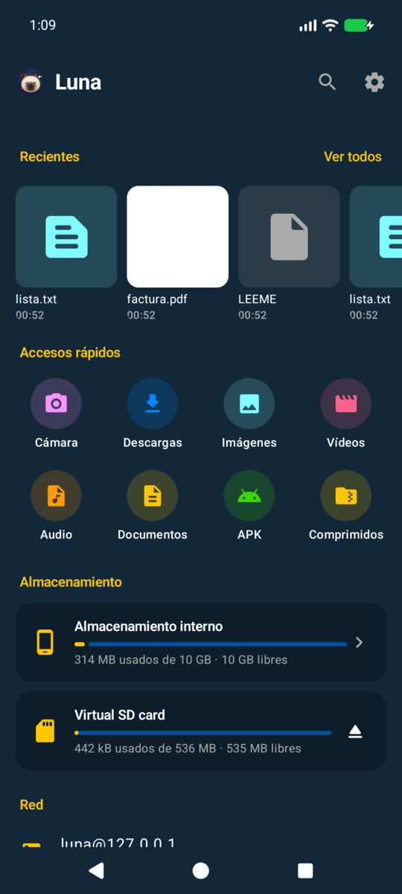
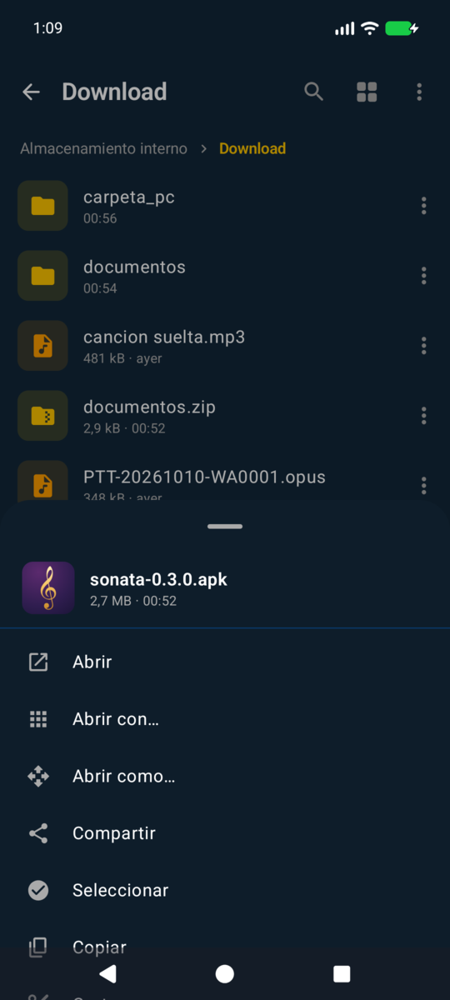
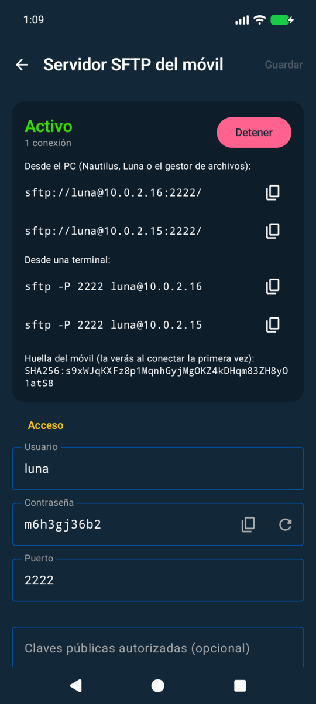

# Luna para Android

Explorador de archivos para el móvil, hermano de [Luna de escritorio](https://github.com/julssvanderhaack/luna)
(C++/Qt6). Mismo nombre, mismo gato siamés y los mismos temas de Omarchy que
[Sonata para Android](../sonata-android), pero pensado para el dedo: accesos rápidos al estilo
de «Mis archivos» de Samsung y un menú de pulsación larga con las opciones del escritorio.

| Inicio | Pulsación larga | Servidor SFTP |
|---|---|---|
|  |  |  |

## Qué hace (v0.4)

- **Menú lateral** (☰): Inicio, Carpeta personal (`/storage/emulated/0`, la «home» del
  móvil), **Raíz** (`/`), cada USB/SD, los accesos rápidos, favoritos, servidores y ajustes.
  Desde `/` se baja por el árbol como en el PC (`/storage/emulated/0`, `/system`…); las
  carpetas que Android no deja listar se completan con las que sí se pueden abrir (`system`,
  `vendor`, `etc`…) y con el camino a cada volumen (`storage` → `emulated` → `0`); las que
  Android bloquea (`data`…) no aparecen. Las migas de pan empiezan siempre en `/`.
- **Inicio**: recientes (sin archivos de apps, ocultos ni `Android/`), accesos rápidos a
  Cámara, Descargas, Imágenes, Vídeos, Audio, Documentos, APK y Comprimidos, almacenamiento
  con espacio libre, favoritos y red.
- **Pendrives, discos USB y tarjetas SD** aparecen solos al conectarlos (y se van al
  quitarlos), con su espacio. Se navegan y escriben como el almacenamiento interno.
  Android no deja a las apps desmontar: el botón de expulsar abre los ajustes de almacenamiento.
- **Pulsación larga** (o ⋮ en cada fila): Abrir, Abrir con…, **Abrir como…** (texto, imagen,
  audio, vídeo, PDF u otro), Compartir, Seleccionar, Copiar, Cortar, Renombrar, Eliminar,
  Extraer aquí (zip), Comprimir…, favoritos, Abrir la carpeta que lo contiene, Copiar ruta y
  Propiedades. Selección múltiple con barra de Copiar / Mover / Compartir / Eliminar / Más;
  también desde ⋮ → **Selección múltiple**, que entra en el modo sin nada marcado para ir
  tocando archivos, o ⋮ → Seleccionar todo.
- Copiar y mover entre cualquier sitio: interno ↔ USB ↔ servidores SFTP. Los nombres que ya
  existen pasan a «nombre (2)», como al pegar en el escritorio. Progreso con cancelar.
- Lista o cuadrícula (recordado aparte para fotos/vídeos y para carpetas), ordenar por
  nombre natural / fecha / tamaño / tipo, ocultos, búsqueda en subcarpetas sin distinguir
  acentos, migas de pan, tirar para recargar. Miniaturas de fotos, vídeos, carátulas, PDF y APK.
- **Visor de fotos propio**: tocar una foto la abre en Luna, sin pasar por la galería. Se
  desliza entre las fotos de la carpeta, se amplía pellizcando o con doble toque (hasta 8×) y
  los GIF/WebP animados se mueven. JPEG, PNG, WebP, GIF, HEIC, BMP, ICO, DNG y AVIF; también
  desde servidores SFTP (hasta 100 MB).
- **Propiedades con metadatos**: en fotos, resolución, formato, compresión (calidad JPEG
  estimada, progresiva, submuestreo; PNG/WebP con o sin pérdida), profundidad, EXIF de la
  cámara y GPS con «Ver en el mapa»; en vídeo y audio, duración, contenedor, bitrate y, por
  pista, códec, resolución, fps, HDR, frecuencia, canales e idioma, además de las etiquetas.
- **Cliente SFTP**: servidores guardados con contraseña (o pedida cada vez) o clave privada
  (`id_ed25519`, `id_rsa`… con frase opcional). La huella del servidor se enseña la primera
  vez y se avisa si cambia. Los archivos remotos se abren descargándolos a la caché.
- **Servidor SFTP en el móvil** para que el PC entre: `sftp://luna@<ip>:2222/` en Nautilus o
  en Luna de escritorio, o `sftp -P 2222 luna@<ip>`. Contraseña aleatoria fácil de teclear,
  claves públicas autorizadas, carpeta raíz (interno o un USB), modo solo lectura. Solo SFTP:
  sin terminal ni redirección de puertos. Notificación con «Detener».
- Los 27 temas de Omarchy, editor de temas e importar/exportar `colors.toml` (de Sonata). Los
  colores de cada tipo de archivo salen de los colores de terminal del tema.

## Rápido en cualquier móvil (v0.3)

- **Miniaturas**, de la fuente más rápida a la más lenta:
  1. memoria (tamaño según la RAM que Android da a la app);
  2. la miniatura que Android ya tiene (`Pictures/.thumbnails`), que la galería suele haber
     hecho: una carpeta de la cámara aparece casi al instante;
  3. la vista previa EXIF que llevan las fotos de cámara (unos 512×384), sin descodificar
     megas de foto;
  4. la caché en disco de Luna (`cache/thumbs`, hasta 200 MB), así cada archivo se
     descodifica una sola vez;
  5. descodificar el archivo, ya al tamaño de la celda y no mayor, en hilos de baja
     prioridad para que el desplazamiento no espere.
- **Carpetas grandes**: una sola llamada al sistema por archivo en vez de cinco y el nombre
  se normaliza una vez, no en cada comparación al ordenar. Una carpeta de 2000 archivos pasa
  de ~4,3 s a ~0,2 s en el emulador.
- **Volver atrás es instantáneo**: se enseña la última lista de la carpeta mientras se lee
  la nueva y se recupera la posición en la que estabas. Sin ruedita de carga si la carpeta
  tarda menos de un cuarto de segundo.
- `profileinstaller`: el perfil de arranque de Compose se compila también al instalar el APK
  a mano (Google Play lo hace solo).

Medido en el emulador (x86, gráficos por software, más lento que cualquier móvil), carpeta
con fotos de 12 MP:

| | v0.2 | v0.3 |
|---|---|---|
| Carpeta de 2000 archivos | 4,3 s | 0,2–0,5 s |
| 10.ª miniatura, fotos de cámara, primera vez | 5,6 s | 0,5 s |
| 10.ª miniatura, segunda vez | 5,6 s | 0,16 s |
| Arranque en frío (mediana) | 2,1 s | 1,9 s |

## Compilar

Android 11+ (minSdk 30: el permiso «acceso a todos los archivos» es lo que deja usar los
USB por ruta). Kotlin + Compose, [Apache MINA SSHD](https://mina.apache.org/sshd-project/)
para el cliente y el servidor SFTP.

```sh
JAVA_HOME=/opt/android-studio/jbr ./gradlew assembleDebug testDebugUnitTest
JAVA_HOME=/opt/android-studio/jbr ./gradlew assembleRelease   # firma con ~/.android/luna-release.properties
```

Los tests de JVM levantan el servidor de Luna y conectan el cliente de Luna contra él
(contraseña, clave pública, huella nueva y cambiada, solo lectura), además de copiar,
mover, comprimir y extraer de verdad.

`tools/import-omarchy-themes.sh` vuelve a copiar los temas instalados.

## Pendiente

- Papelera (MediaStore la tiene para fotos/vídeos/audio).
- Discos NTFS que el móvil no monta (haría falta libaums o similar).
- Copias largas en un servicio en primer plano (ahora siguen al salir de la pantalla, no si
  Android mata la app).
- Más protocolos (SMB/WebDAV), textos en inglés.

## Licencia

GPL-3.0, como Luna de escritorio. Los temas son de sus autores en Omarchy.
